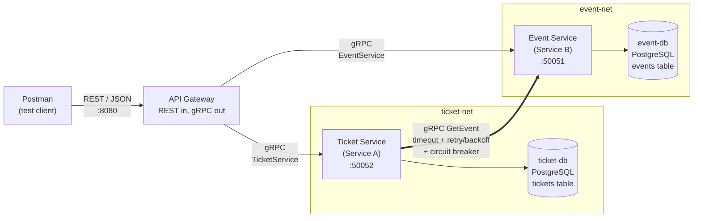

# Event Ticketing: Two Collaborating Microservices

WEB303 Microservices & Serverless Applications, Programming Assignment.

A small event-ticketing system for Bhutanese festivals and concerts, built from two Go
microservices that talk over **gRPC**, sit behind a REST **API Gateway**, and each own their own
**PostgreSQL** database.

| Role | Service | Resource | Database |
|---|---|---|---|
| **Service B** (independent) | `event-service` | **Event**: name, venue, start time, capacity, price | `event-db` |
| **Service A** (dependent) | `ticket-service` | **Ticket**: event, holder, email, quantity, status | `ticket-db` |
| Entry point | `api-gateway` | REST → gRPC translation | none |

A ticket can't exist without an event. The Ticket Service stores only the `event_id`. Whenever
it needs event data, it asks the Event Service over gRPC:

* **Create ticket** checks that the event exists, hasn't started yet, and still has enough free seats.
* **Get ticket** adds the event's name, venue, date and price to the response.
* **Update ticket** (to CONFIRMED) checks capacity again.

---

## Architecture



* **Postman talks only to the gateway.** It's the only container that publishes a port to the host.
* **The gateway** routes `/events/**` to the Event Service and `/tickets/**` to the Ticket Service
  over gRPC. It also maps gRPC status codes to HTTP status codes.
* **Database per Service.** Each database sits on its own private Docker network
  (`event-net`, `ticket-net`) that only its owning service joins. The Ticket Service has no
  network route to `event-db` and no credentials for it. `tickets.event_id` is deliberately
  **not** a foreign key, because the `events` table lives in a different database.

### Repository layout

```
proto/                      .proto contracts (source of truth)
  event/event.proto           EventService - Service B
  ticket/ticket.proto         TicketService - Service A
gen/                        Go code generated from the protos (scripts/gen-proto.sh)
event-service/              Service B
  cmd/main.go                 config from env, DB, gRPC server
  internal/server/            gRPC handlers (thin) + error -> status-code mapping
  internal/repository/        all SQL for event-db
  internal/validation/        input rules
  Dockerfile                  multi-stage build
ticket-service/             Service A
  cmd/main.go
  internal/server/            gRPC handlers; calls Event Service
  internal/eventclient/       resilient Event Service client (timeout, retry, breaker)
  internal/repository/        all SQL for ticket-db (incl. capacity check)
  internal/validation/
  Dockerfile
api-gateway/                REST entry point
  cmd/main.go                 routes, gRPC clients
  internal/handlers/          REST handlers, JSON in/out
  internal/apierror/          gRPC code -> HTTP status table
  internal/middleware/        logging, request timeout, panic recovery
  Dockerfile
internal/                   small helpers shared by all three (env config, postgres, logging)
docker-compose.yml          the whole system: 2 DBs + 2 services + gateway
.env.example                every configurable value
postman/                    exported Postman collection
```

---

## Running it

**Requirements:** Docker Desktop (with Compose v2). You don't need Go or protoc on your machine,
because everything is compiled inside the multi-stage Docker builds.

```bash
git clone <this-repo> && cd event-ticketing
docker compose up --build
```

The gateway is now at **http://localhost:8080**. Check it with `curl localhost:8080/healthz`.

All ports, database credentials and resilience settings are environment variables. To change
them, copy `.env.example` to `.env` and edit it. For example, if port 8080 is already in use,
set `GATEWAY_PORT=8088`. Compose reads `.env` automatically. `docker-compose.yml` has a default
for each variable, so the project also runs without a `.env` file.

Stop everything with `docker compose down`. Add `-v` to delete the database volumes too.

### Postman

Import `postman/event-ticketing.postman_collection.json`. Change the `baseUrl` collection
variable if you're not using port 8080.

1. Run folders **1 → 2 → 3 → 5** with the Collection Runner. Requests chain together:
   *Create event* saves `{{eventId}}` and *Create ticket* saves `{{ticketId}}`. The pre-request
   script computes a future `starts_at`, so the collection works on any date.
2. For folder **4 (Resilience)**: run folders 1 and 2 first, then
   `docker compose stop event-service`, then send the requests in folder 4.

---

## REST API (gateway)

| Method | URL | Success | gRPC call |
|---|---|---|---|
| POST | `/events` | 201 + `Location` | `EventService.CreateEvent` |
| GET | `/events` | 200 | `EventService.ListEvents` |
| GET | `/events/{id}` | 200 | `EventService.GetEvent` |
| PUT | `/events/{id}` | 200 | `EventService.UpdateEvent` |
| DELETE | `/events/{id}` | 204 | `EventService.DeleteEvent` |
| POST | `/tickets` | 201 + `Location` | `TicketService.CreateTicket` → `EventService.GetEvent` |
| GET | `/tickets` (`?event_id=` optional) | 200 | `TicketService.ListTickets` |
| GET | `/tickets/{id}` | 200 (with event details) | `TicketService.GetTicket` → `EventService.GetEvent` |
| PUT | `/tickets/{id}` | 200 | `TicketService.UpdateTicket` (→ `GetEvent` if CONFIRMED) |
| DELETE | `/tickets/{id}` | 204 | `TicketService.DeleteTicket` |

Example bodies:

```jsonc
// POST /events   (PUT /events/{id} takes the same body)
{ "name": "Tshechu Night Concert", "venue": "Clock Tower Square, Thimphu",
  "starts_at": "2026-12-17T18:00:00+06:00", "capacity": 5, "price": 500 }

// POST /tickets
{ "event_id": "<uuid>", "holder_name": "Pema Wangmo", "holder_email": "pema@rub.edu.bt", "quantity": 2 }

// PUT /tickets/{id}
{ "holder_name": "Pema Wangmo", "holder_email": "pema@rub.edu.bt", "quantity": 3, "status": "CANCELLED" }
```

### Errors

Every error has the same JSON shape: `{"error": "<message>", "code": "<GRPC_CODE>"}`.
All mapping happens in one table in
[`api-gateway/internal/apierror/apierror.go`](api-gateway/internal/apierror/apierror.go):

| gRPC code | HTTP | Example |
|---|---|---|
| `INVALID_ARGUMENT` | 400 | bad email, quantity 0, malformed UUID, malformed JSON |
| `NOT_FOUND` | 404 | unknown event/ticket, ticket for an event that does not exist |
| `ALREADY_EXISTS` | 409 | (reserved) |
| `FAILED_PRECONDITION` | 409 | event sold out, event already started |
| `UNAVAILABLE` | 503 | Event Service down / circuit breaker open |
| `DEADLINE_EXCEEDED` | 504 | gateway request timeout reached |
| anything else | 500 | details are logged, never returned to the client |

### Validation

Validation runs **inside each service, before the database is touched**. That way invalid data
can't be stored even if someone calls the gRPC API directly and skips the gateway. All invalid
fields are reported together. The database `CHECK` constraints are a second line of defence.

* **Event**: `name` required (≤100 chars); `venue` required (≤150 chars); `starts_at` required
  and in the future; `capacity` from 1 to 100000; `price` from 0 to 1000000; `id` must be a UUID.
* **Ticket**: `event_id` must be a UUID; `holder_name` required (≤100 chars); `holder_email` must
  be a valid address; `quantity` from 1 to 10; `status` must be `CONFIRMED` or `CANCELLED`.
* **Gateway**: the body must be well-formed JSON with correct types, no unknown fields, and an
  RFC 3339 timestamp.

---

## Resilience (Ticket Service → Event Service)

All calls go through
[`ticket-service/internal/eventclient`](ticket-service/internal/eventclient/client.go).
It applies three layers:

```
circuit breaker  ->  retry with exponential backoff + jitter  ->  per-attempt timeout  ->  gRPC GetEvent
```

| Pattern | Behaviour | Env variable (default) |
|---|---|---|
| Timeout | each attempt is cancelled after this long | `EVENT_CALL_TIMEOUT` (1s) |
| Retry | up to N attempts in total, **only** for `UNAVAILABLE` / `DEADLINE_EXCEEDED` | `EVENT_CALL_MAX_ATTEMPTS` (3) |
| Backoff | 200ms, then 400ms, … plus up to 50% random jitter | `EVENT_CALL_BACKOFF` (200ms) |
| Circuit breaker | opens after N consecutive failed calls; while open it fails instantly | `CB_FAILURE_THRESHOLD` (3) |
| Breaker reset | after this long it goes half-open and lets one trial call through | `CB_OPEN_TIMEOUT` (15s) |

Business errors like `NOT_FOUND` are **not retried** and **don't count as failures** for the
breaker (`IsSuccessful`). Someone typing a few wrong event IDs shouldn't cut every user off
from the Event Service.

**What happens when the Event Service is stopped:**

| Request | Result |
|---|---|
| `POST /tickets` | **503** with a clear message. A ticket can't be sold without confirming the event. The first calls take about 1–2s (retries); once the breaker is open they fail in milliseconds. |
| `GET /tickets/{id}` | **200** fallback. The ticket comes from the Ticket Service's own database, with `"event": null` and a `"warning"`. |
| `PUT /tickets/{id}` with `CANCELLED` | **200**. Cancelling doesn't need event data. |
| `GET /events/...` | **503** from the gateway. Its gRPC clients have their own connect timeout (`GATEWAY_GRPC_CONNECT_TIMEOUT`, 2s) and request timeout (`GATEWAY_REQUEST_TIMEOUT`, 10s), so nothing hangs. |

### Demo

```bash
docker compose stop event-service
# send "Create ticket while Event Service is down" 4 times, then "Get ticket while ... down"
docker compose logs -f ticket-service       # retries, backoff and breaker state changes
docker compose start event-service          # wait ~15s, then create a ticket again
```

Log lines to look for:

```
msg="event-service call failed" attempt=1 max_attempts=3 code=DeadlineExceeded
msg="retrying event-service call" next_attempt=2 backoff=268ms
msg="circuit breaker state changed" from=closed to=open
msg="circuit open: failing fast without calling event-service"
msg="returning ticket without event details (fallback)"
msg="circuit breaker state changed" from=open to=half-open
msg="event-service call succeeded after retry" attempt=3
msg="circuit breaker state changed" from=half-open to=closed
```

### Capacity and consistency

Seat capacity belongs to the Event Service, and sold seats belong to the Ticket Service. When a
ticket is created, the Ticket Service gets `capacity` over gRPC and adds up its **own**
`tickets` rows for that event. It does this inside a transaction with a per-event Postgres
advisory lock, so two buyers can't both take the last seat. Neither service reads the other's
tables.

---

## Showing that each database only has its own data

```bash
docker compose exec event-db  psql -U event_svc  -d events  -c '\dt' -c 'SELECT id, name, capacity FROM events;'
docker compose exec ticket-db psql -U ticket_svc -d tickets -c '\dt' -c 'SELECT id, event_id, quantity, status FROM tickets;'
```

After sending an invalid request, run the same `SELECT` again. It shows that nothing was stored.

## Development

```bash
# regenerate gen/ after editing a .proto (runs protoc inside a container)
docker run --rm -v "$PWD":/src -w /src golang:1.23-alpine sh scripts/gen-proto.sh

# unit tests (validation, error mapping, retry/breaker behaviour)
docker run --rm -v "$PWD":/src -w /src golang:1.23-alpine go test ./...
```

You can inspect the services directly with `grpcurl`, because both have gRPC server reflection
enabled. They're only reachable inside the compose network.
