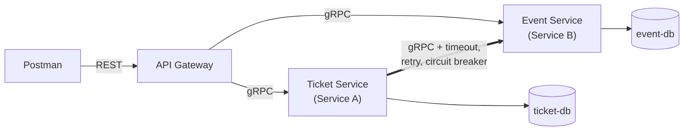

# Event Ticketing – Two Collaborating Microservices

WEB303 Microservices & Serverless Applications – Programming Assignment 1

A small ticketing system for Bhutanese festivals and concerts. It is built from two Go
microservices that talk over **gRPC**, sit behind a REST **API Gateway**, and each own their
own **PostgreSQL** database.

| Role | Service | Resource | Database |
|---|---|---|---|
| Service B (independent) | `event-service` | **Event**: name, venue, start time, capacity, price | `event-db` |
| Service A (dependent) | `ticket-service` | **Ticket**: event, holder name, email, quantity, status | `ticket-db` |
| Entry point | `api-gateway` | REST in, gRPC out | – |

A ticket always belongs to an event. The Ticket Service stores only the `event_id` and calls
the Event Service over gRPC to:

* confirm the event exists, hasn't started and has free seats before **creating** a ticket
* add the event's name, venue, date and price when **retrieving** a ticket

## Architecture



* Postman calls **only** the gateway. It is the only container with a port open to the host.
* **Database per Service:** each database is on its own private Docker network that only its
  owner can reach. The Ticket Service can get event data only through the Event Service's gRPC API.

## Project structure

```
proto/            .proto files (event.proto, ticket.proto)
gen/              Go code generated from the .proto files
event-service/    Service B – cmd/main.go, internal/{server,repository,validation}, Dockerfile
ticket-service/   Service A – same layout + internal/eventclient (timeout, retry, circuit breaker)
api-gateway/      REST gateway – routes, handlers, gRPC→HTTP error mapping, Dockerfile
internal/         small shared helpers (env config, postgres connection, logging)
postman/          exported Postman collection
docker-compose.yml
.env.example      every configurable value
```

## How to run

You only need **Docker Desktop**. Go is compiled inside the multi-stage Dockerfiles.

```bash
git clone https://github.com/Gayley007/event-ticketing.git
cd event-ticketing
docker compose up --build
```

The gateway runs at **http://localhost:8080**. Check it with `curl http://localhost:8080/healthz`.

All ports, database credentials and resilience settings come from environment variables. To
change them, copy `.env.example` to `.env` and edit it, e.g. `GATEWAY_PORT=8088` if port 8080 is
already in use.

Stop with `docker compose down` (add `-v` to also delete the database data).

## Testing with Postman

1. **Import** `postman/event-ticketing.postman_collection.json`.
2. In the collection's **Variables** tab, set `baseUrl` to your gateway URL (default
   `http://localhost:8080`) and save.
3. Send the requests in folders **1 → 2 → 3 → 5** in order. *Create event* and *Create ticket*
   save the new IDs automatically for the requests after them.
4. **Folder 4 (resilience):** run `docker compose stop event-service`, send the requests, then
   `docker compose start event-service`.

## REST API

| Method | URL | Success |
|---|---|---|
| POST | `/events` | 201 |
| GET | `/events` | 200 |
| GET | `/events/{id}` | 200 |
| PUT | `/events/{id}` | 200 |
| DELETE | `/events/{id}` | 204 |
| POST | `/tickets` | 201 |
| GET | `/tickets` (optional `?event_id=`) | 200 |
| GET | `/tickets/{id}` | 200 |
| PUT | `/tickets/{id}` | 200 |
| DELETE | `/tickets/{id}` | 204 |

Example bodies:

```json
POST /events
{ "name": "Tshechu Night Concert", "venue": "Clock Tower Square, Thimphu",
  "starts_at": "2026-12-17T18:00:00+06:00", "capacity": 5, "price": 500 }

POST /tickets
{ "event_id": "<event id>", "holder_name": "Pema Wangmo",
  "holder_email": "pema@rub.edu.bt", "quantity": 2 }
```

### Error mapping (gRPC → HTTP)

Errors are returned as `{"error": "...", "code": "..."}`.

| gRPC code | HTTP | Example |
|---|---|---|
| `INVALID_ARGUMENT` | 400 | missing name, bad email, invalid UUID, malformed JSON |
| `NOT_FOUND` | 404 | event or ticket does not exist |
| `FAILED_PRECONDITION` | 409 | event sold out or already started |
| `UNAVAILABLE` | 503 | Event Service down / circuit breaker open |
| `DEADLINE_EXCEEDED` | 504 | request took too long |

### Validation

Each service validates input **before** saving, so invalid data is never stored.

* **Event:** name and venue required, `starts_at` in the future, capacity 1–100000, price ≥ 0
* **Ticket:** valid event UUID, holder name required, valid email, quantity 1–10,
  status `CONFIRMED` or `CANCELLED`

## Resilience (Ticket Service → Event Service)

Implemented in `ticket-service/internal/eventclient/client.go`:

| Pattern | Behaviour | Env variable (default) |
|---|---|---|
| Timeout | each attempt is cancelled after this long | `EVENT_CALL_TIMEOUT` (1s) |
| Retry + backoff | up to 3 attempts, waiting 200ms, 400ms… between them | `EVENT_CALL_MAX_ATTEMPTS`, `EVENT_CALL_BACKOFF` |
| Circuit breaker | opens after 3 failed calls in a row, then fails instantly for 15s | `CB_FAILURE_THRESHOLD`, `CB_OPEN_TIMEOUT` |

When the Event Service is stopped:

* `POST /tickets` → **503** with a clear message (fails instantly once the breaker is open)
* `GET /tickets/{id}` → **200** fallback: the ticket is returned with `"event": null` and a warning
* Cancelling a ticket still works, because it doesn't need event data

See it in the logs with `docker compose logs ticket-service`.

## Checking each database

```bash
docker compose exec event-db  psql -U event_svc  -d events  -c "SELECT id, name, capacity FROM events;"
docker compose exec ticket-db psql -U ticket_svc -d tickets -c "SELECT id, event_id, quantity, status FROM tickets;"
```
